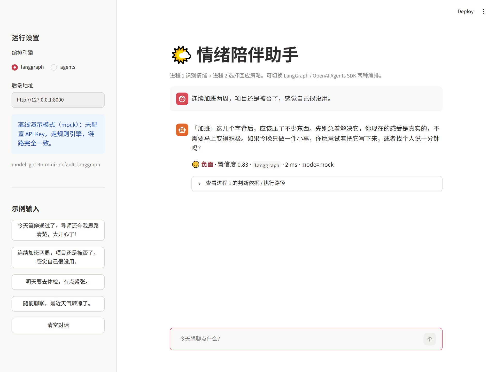
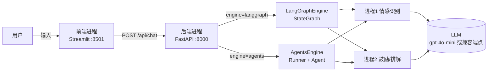
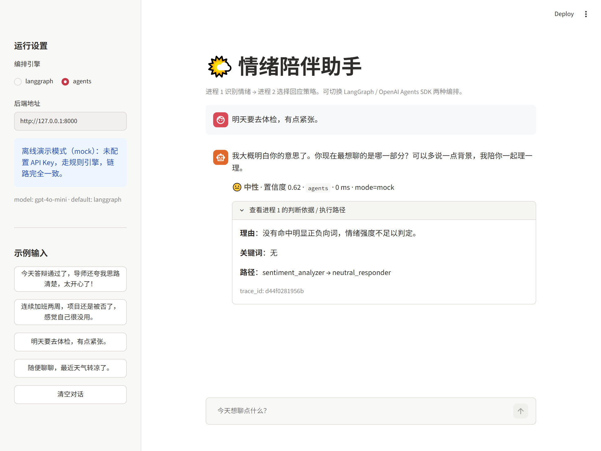

# 情绪陪伴助手 · 双引擎版

> Week15 作业 1 + 作业 2。
> 作业 1：分别用 **LangGraph** 和 **OpenAI Agents SDK** 实现「情感识别 → 鼓励/排解」流水线。
> 作业 2：基于 Agents SDK 版本编写 **Dockerfile**，构建镜像并推送到 **阿里云容器镜像服务（ACR）**。



---

## 1. 作业要求与实现对应

| 作业描述 | 本项目中的位置 | 说明 |
| --- | --- | --- |
| 进程 1：接受请求进行情感识别 | `app/engines/langgraph_engine.py::_analyze`<br>`app/engines/agents_engine.py::_run` 第一步 | 结构化输出 `Sentiment(label, confidence, reason, keywords)` |
| 进程 2：正向鼓励 / 负面排解 | `encourage` / `comfort` 节点与 `encourager` / `comforter` Agent | 另有 `neutral`、`crisis` 两个兜底分支 |
| 后端进程：串联进程 1、2 | `app/main.py` + `app/engines/*` | FastAPI 接收前端输入，按 `engine` 参数选择编排实现 |
| 前端进程：用户输入 | `frontend/streamlit_app.py` | 聊天界面，展示情绪标签、置信度、耗时、执行路径 |

两套实现共用同一份 `app/prompts.py` 和 `app/schemas.py`，只有「怎么编排」不同，因此对比是公平的。

---

## 2. 架构



LangGraph 版把流程画成图，路由是**条件边**：

```
START → analyze ─┬─(positive)→ encourage ─┐
                 ├─(negative)→ comfort   ─┼→ END
                 ├─(neutral) → neutral   ─┤
                 └─(crisis)  → crisis    ─┘
```

Agents SDK 版是**两段式**：`Runner.run(sentiment_agent)` 拿到结构化结果，再由 Python 分支选择回应 Agent。



---

## 3. 目录结构

```
week15/
├── app/
│   ├── main.py                    # 后端进程：FastAPI 入口
│   ├── config.py                  # 环境变量配置
│   ├── schemas.py                 # Sentiment / ChatRequest / ChatResponse
│   ├── prompts.py                 # 两套引擎共用的 Prompt + 危机关键词
│   ├── llm.py                     # ChatOpenAI 工厂
│   ├── mock.py                    # 离线规则引擎（无 Key 也能演示 / 单测）
│   └── engines/
│       ├── base.py                # Engine 抽象 + 失败降级
│       ├── langgraph_engine.py    # 作业 1-A：StateGraph
│       ├── agents_engine.py       # 作业 1-B：Agents SDK
│       └── registry.py            # 引擎装配
├── frontend/streamlit_app.py      # 前端进程
├── frontend/requirements.txt      # 前端独立依赖（不进后端镜像）
├── tests/                         # 20 个用例，全部离线
├── eval/
│   ├── cases.jsonl                # 12 条评测语料
│   ├── compare.py                 # 双引擎对比实验
│   └── report.md                  # 自动生成的对比报告
├── docs/                          # 界面截图
├── deploy/aliyun.md               # 作业 2：ACR 推送 / ECS 运行手册
├── scripts/push-acr.ps1           # 一键 build + tag + push
├── Dockerfile                     # 作业 2：Agents 版本后端镜像
├── Dockerfile.frontend            # 前端镜像（Streamlit，与后端解耦）
├── docker-compose.yml             # API + 前端一键起
├── requirements.txt
└── .env.example
```

---

## 4. 本地运行

需要 Python 3.12。

```bash
python -m venv .venv
.venv\Scripts\activate            # macOS/Linux: source .venv/bin/activate
pip install -r requirements.txt -r frontend/requirements.txt
```

### 4.1 不配 Key 直接跑（离线演示）

不设置 `LLM_API_KEY` 时自动进入 `mock` 模式：用关键词规则完成分类与回应，**链路、接口、路由、前端完全一致**，只是回复是模板文案。适合答辩现场没有网络或不想烧 token 的场景。

```bash
uvicorn app.main:app --reload          # 后端 http://127.0.0.1:8000
streamlit run frontend/streamlit_app.py # 前端 http://127.0.0.1:8501
```

### 4.2 接真实模型

```bash
copy .env.example .env
# 编辑 .env，填 LLM_API_KEY；国内模型改 LLM_BASE_URL + LLM_MODEL 即可
```

任何 OpenAI 兼容端点都能用（DeepSeek、通义千问、vLLM、Ollama 的 `/v1` 等），因为两套实现都支持自定义 `base_url`。

---

## 5. 两套实现的关键差异

| 维度 | LangGraph | OpenAI Agents SDK |
| --- | --- | --- |
| 编排抽象 | 显式状态图（节点 + 边） | Agent + Runner |
| 条件分支 | `add_conditional_edges`，路由是纯函数 | Python `if/else` 选择 Agent |
| 状态 | `TypedDict` + reducer（`trail` 就是靠 `operator.add` 累积的） | `RunResult` |
| 可视化 | `graph.get_graph().draw_mermaid()` 原生出图 | 平台 trace 时间线 |
| 代码量 | 约 126 行，结构最清晰 | 约 110 行，声明式更短 |
| 多轮记忆 | 加 `checkpointer` 即可 | `session` 开箱即用 |
| 供应商 | 模型无关 | 默认 OpenAI，可换 `base_url` |
| 适合场景 | 分支多、流程固定、要审计 | 快速搭 Agent、工具多、要 trace |

**为什么 Agents SDK 版没用 `handoff`？**
`handoff` 的语义是「把对话控制权移交给另一个 Agent」，由模型自己决定交给谁，路由不可测、不可控；而作业要的是「先识别、再按结果选择回应方式」的确定性流水线。所以这里用「结构化输出 + Python 分支」，把不确定性关在进程 1 内部。如果老师要求演示 handoff，可以把 `encourager` / `comforter` 放进 triage agent 的 `handoffs=[...]`，代价是路由变成模型决策。

---

## 6. 接口

### `POST /api/chat`

```json
// 请求
{ "text": "连续加班两周，项目还是被否了。", "engine": "agents" }

// 响应
{
  "reply": "「加班」这几个字背后，应该压了不少东西……",
  "sentiment": {
    "label": "negative",
    "confidence": 0.83,
    "reason": "文本中出现负向表达：加班、被否、没用。",
    "keywords": ["加班", "被否", "没用"]
  },
  "engine": "agents",
  "mode": "mock",
  "crisis": false,
  "trail": ["sentiment_analyzer", "comforter"],
  "latency_ms": 2,
  "trace_id": "d44f0281956b"
}
```

| 字段 | 说明 |
| --- | --- |
| `mode` | `live` 真实模型 / `mock` 离线规则 / `fallback` 模型失败自动降级 |
| `crisis` | 命中自伤关键词，走了安全兜底，不进入普通疏导 |
| `trail` | 执行路径，前端「查看执行路径」直接展示，答辩时很直观 |

其他接口：`GET /api/health`（模式、模型、可用引擎）、`GET /api/engines`、`GET /docs`（Swagger）。

---

## 7. 测试与对比实验

```bash
pytest                                  # 20 passed，全部离线
python -m eval.compare                  # 生成 eval/report.md
python -m eval.compare --engine agents  # 只跑一个引擎
```

测试覆盖三层：

1. **分类器**：正/负/中性、否定词陷阱（「不开心」）、危机关键词；
2. **路由**：两套引擎对同一输入必须走同一条路径（`trail` 断言）；
3. **接口**：引擎切换、参数校验、危机短路、未知引擎 400。

`eval/report.md` 是自动生成的对比表（准确率 / 平均耗时 / 逐条结果）。mock 模式下两套引擎共享同一份规则，准确率必然一致——这正好说明**差异只在编排层，不在业务逻辑**；接真实模型后才会出现 Prompt 遵循度、结构化输出成功率等差异。

---

## 8. 作业 2：Docker 打包

### 8.1 构建与运行

```bash
docker build -t sentiment-companion:agents .
docker run -d --name sentiment-api -p 8000:8000 sentiment-companion:agents
curl http://127.0.0.1:8000/api/health
```

不传 Key 也能起来（自动 mock）。要接真实模型：

```bash
docker run -d -p 8000:8000 --env-file .env sentiment-companion:agents
```

### 8.2 一键起后端 + 前端

```bash
docker compose up -d --build
# 后端 http://127.0.0.1:8000/docs
# 前端 http://127.0.0.1:8501
```

### 8.3 推送到阿里云 ACR

```powershell
docker login --username=<阿里云账号> registry.cn-hangzhou.aliyuncs.com
.\scripts\push-acr.ps1 -Namespace week15 -Repo sentiment-companion -Tag v1
```

完整步骤（创建命名空间、ECS 拉取、ACR 在线构建、排错）见 [`deploy/aliyun.md`](deploy/aliyun.md)。

### 8.4 镜像设计要点

- **多阶段不需要**，但做了分层缓存：先 `COPY requirements.txt` 再 `COPY app`，改代码不重装依赖。
- **国内构建友好**：`PIP_INDEX_URL` 默认阿里云 PyPI，可用 `--build-arg` 覆盖；基础镜像也可用 `--build-arg BASE_IMAGE=docker.m.daocloud.io/library/python:3.12-slim` 换源。
- **非 root 运行**：`uid 10001`，`chown` 应用目录。
- **健康检查**：`HEALTHCHECK` 用 Python 标准库请求 `/api/health`，不额外装 curl。
- **默认引擎**：`ENV DEFAULT_ENGINE=agents`，镜像启动即是作业 1 的 Agents SDK 版本。

```bash
docker images sentiment-companion:agents
# REPOSITORY                  TAG      SIZE
# sentiment-companion         agents   427MB
```

后端镜像只有 API 依赖（427 MB）；前端单独用 `Dockerfile.frontend` 构建（Streamlit + pandas/pyarrow，801 MB），两者解耦，改前端不用重推后端镜像。

---

## 9. 配置项

| 变量 | 默认值 | 说明 |
| --- | --- | --- |
| `APP_MODE` | `auto` | `auto` 有 Key 就 live；`mock` 强制离线；`live` 强制真实 |
| `LLM_API_KEY` / `OPENAI_API_KEY` | 空 | 为空自动 mock |
| `LLM_BASE_URL` | `https://api.openai.com/v1` | 兼容端点改这里 |
| `LLM_MODEL` | `gpt-4o-mini` |  |
| `LLM_TIMEOUT` | `60` | 秒 |
| `DEFAULT_ENGINE` / `ENGINE` | `langgraph` | 镜像里覆盖为 `agents` |
| `API_BASE` | `http://127.0.0.1:8000` | 前端请求的后端地址 |

---

## 10. 设计取舍与边界

1. **三分类而不是二分类**：只有正/负两种标签时，「中性」「讽刺」「判不准」无路可走。三分类 + `neutral` 节点保证了全链路可兜底。
2. **安全优先于成本**：命中自伤关键词时**不调用模型**，直接返回危机干预话术（含 12356 热线），并打 `crisis=true`。这类输入不适合交给「负面排解」的通用 Prompt。
3. **降级不降体验**：模型超时/限流/结构化输出失败时自动切到 mock，响应里 `mode=fallback`，演示不会因为网络挂掉。
4. **不做心理诊断**：排解类 Prompt 明确禁止临床词汇和「一定会好起来」式承诺；这是陪伴类应用的合规底线。
5. **单轮对话**：作业要求是单轮流水线。要扩展多轮，LangGraph 加 `MemorySaver`、Agents SDK 加 `session`，业务代码不用动。

## 11. 已知限制

- `mock` 模式是关键词规则，抓不到反讽（`eval/report.md` 第 8 条就是反例），只用于演示与单测，不代表模型能力。
- 没有接数据库，对话不持久化；刷新页面即清空。
- 单实例部署，未做限流与鉴权；公网部署前应加 API Key 鉴权与速率限制。
