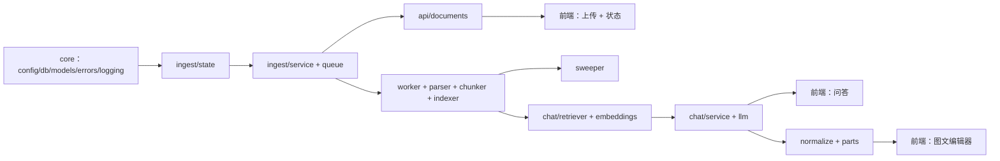

# 实现清单与开发步骤

> 状态：S0～S3 ✅、S4 ✅（3 份完整 PDF 四态、Kafka 重复消息回放、Milvus Lite server 正式替代；Docker Milvus standalone 为后续部署项）、S5 ✅、S6 ✅、S7 ✅（82 个测试通过）。代码阶段完成。本清单依据 [README](../README.md) 的接口/状态机/目录，与 [AGENTS.md](../AGENTS.md) 的规则；实现时以这两份文件为准。
> 规模估算：后端约 40 个文件、前端约 12 个文件，合计 **约 5,000 行**（含测试）。

## 1. 总览

| 部分 | 文件数 | 预估行数 | 说明 |
|---|---:|---:|---|
| 后端 core | 8 | ~600 | 配置、DB、模型、错误、日志、中间件、装配 |
| 后端 ingest | 8 | ~900 | 上传、状态机、Kafka、解析、分块、入库、补偿、Worker |
| 后端 chat | 6 | ~700 | 图片、parts、检索、LLM、编排、向量编码 |
| 后端 API | 5 | ~350 | documents / chat / kb / health / deps |
| 脚本 | 4 | ~250 | schema、API key、评测、演示数据 |
| 测试 | ~10 | ~700 | 单元 / 集成 / e2e / fixtures |
| 前端 | 12 | ~1,200 | 页面、样式、上传、状态、图文问答 |
| 部署/配置 | 3 | ~150 | compose、requirements、.env.example |

**实现原则**

1. **Mock 先行**：所有外部依赖（Kafka/Milvus/MinerU/LLM）都能在 `RAG_MOCK_EXTERNAL=1` 下跑通，再逐个换真。
2. **契约先行**：先冻结 `schemas.py` 与接口路径，前端即可并行。
3. **每一步可演示**：S0～S7 每步结束都有可运行、可验收的增量。
4. **状态机是地基**：上传、Worker、前端轮询、补偿都依赖它，必须先写。

---

## 2. 后端代码清单

### 2.1 基础设施（core）

| 文件 | 职责 | 关键接口 | 依赖 | 优先级 |
|---|---|---|---|---|
| `app/config.py` | 全部环境变量、`RAG_DATA_DIR` 派生、启动校验 | `Settings`、`get_settings()` | — | P0 |
| `app/db.py` | SQLite engine、WAL/busy_timeout、Session、`utcnow`、幂等迁移 | `engine`、`Session`、`init_db()` | config | P0 |
| `app/models.py` | `files`、`kb_api_keys` 表 | `File`、`KbApiKey` | db | P0 |
| `app/errors.py` | 稳定错误码 + 中文文案 + `AppError` + 异常处理器 | `ERROR_TEXT`、`AppError` | — | P0 |
| `app/logging_setup.py` | 控制台/文件/error handler、轮转、trace_id filter、JSON 开关 | `setup_logging(process)`、`trace_id_var` | config | P0 |
| `app/middleware.py` | 生成/回传 `X-Trace-Id`、请求日志、耗时 | `TraceMiddleware` | logging | P1 |
| `app/schemas.py` | 上传/状态/问答的 Pydantic 模型 | `UploadBatchResponse`、`DocumentItem`、`StatusBatchResponse`、`ChatResponse` | — | P0 |
| `app/main.py` | 装配：lifespan、路由、静态与前端挂载、异常/中间件、`/health` | `app`、`lifespan` | 全部 | P0 |

### 2.2 入库域（ingest）

| 文件 | 职责 | 关键接口 | 依赖 | 优先级 |
|---|---|---|---|---|
| `app/ingest/state.py` | 状态机唯一入口、合法迁移、乐观锁 | `transition()`、`mark_parsing/done/failed()`、`reset_for_reparse()` | db | P0 |
| `app/ingest/service.py` | 批量上传编排、流式落盘、sha256 去重、列表/状态/重解析/删除 | `upload_batch()`、`list_documents()`、`get_statuses()`、`reparse()`、`delete()` | db、queue、state | P0 |
| `app/ingest/queue.py` | confluent-kafka producer 单例、发送重试、mock 记录 | `enqueue()`、`close()` | config | P0 |
| `app/ingest/parser.py` | MinerU CLI 适配、`content_list.json` 解析、mock 产物 | `parse_document()`、`ParseError` | config | P1 |
| `app/ingest/chunker.py` | block → chunk，保留 `page_idx`，图片挂 chunk | `chunk_blocks()`、`Chunk` | parser | P1 |
| `app/ingest/indexer.py` | 分块编码、构建 Milvus 记录、delete→insert→flush | `index_document()` | embeddings、milvus | P1 |
| `app/ingest/sweeper.py` | 僵尸 `PENDING`、超时 `PARSING` 收敛 | `sweep_once()`、`run_forever()` | state、queue | P1 |
| `app/worker.py` | 消费循环 / `--mock` DB 轮询、重试、DLQ、commit | `ParseWorker.run()`、`process_payload()` | ingest | P1 |

> Worker 放在 `app/worker.py`（规则要求），入口 `python -m app.worker [--mock]`。

### 2.3 问答域（chat）

| 文件 | 职责 | 关键接口 | 依赖 | 优先级 |
|---|---|---|---|---|
| `app/embeddings.py` | BGE / Chinese-CLIP 模型单例、文本/图片编码、mock 向量 | `encode_text()`、`encode_image()` | sentence-transformers | P1 |
| `app/chat/normalize.py` | 图片校验、EXIF 转正、RGB、长边 1280、JPEG q85、临时落盘 | `normalize_images()` | pillow | P1 |
| `app/chat/parts.py` | `![图N]` 占位符解析、有序 parts、来源标签、预算裁剪 | `build_parts()`、`UsedImage` | schemas | P1 |
| `app/chat/retriever.py` | 查询编码、三路检索、RRF 融合、只查 `DONE`、sources 组装 | `retrieve()` | embeddings、milvus | P1 |
| `app/chat/llm.py` | OpenAI 兼容调用、Qwen/Qwen-VL 切换、token 统计 | `generate()` | openai | P1 |
| `app/chat/service.py` | 编排：归一化→检索→parts→生成→响应与耗时 | `answer()` | 上述全部 | P1 |

> `embeddings.py` 与 `middleware.py` 是相对 AGENTS.md 目录树新增的共享模块，落地时同步补进规则树。

### 2.4 API 层

| 文件 | 职责 | 路由 | 优先级 |
|---|---|---|---|
| `app/api/deps.py` | 设置注入、`X-API-Key` 校验、分页、上传大小限制 | 依赖函数 | P0 |
| `app/api/documents.py` | 批量上传、列表、批量状态、重解析、删除、旧接口兼容 | `POST /upload/documents` 等 | P0 |
| `app/api/chat.py` | multipart 图文问答（`question` + `images[]` + 参数） | `POST /chat` | P1 |
| `app/api/kb.py` | 知识库 API Key 注册 | `POST /kb/api-keys` | P2 |
| `app/api/health.py` | 基础健康、依赖连通性探测 | `GET /health`、`/health/deps` | P0 |

### 2.5 脚本、测试、部署

| 文件 | 职责 | 优先级 |
|---|---|---|
| `scripts/ensure_milvus_schema.py` | 检查/预建 Milvus 集合 | P1 |
| `scripts/register_api_key.py` | 生成并注册 API Key | P2 |
| `scripts/run_evaluation.py` | 按口径批量评测 | P2 |
| `scripts/smoke_acceptance.py` | 真实环境冒烟（健康、上传、状态、问答、去重） | P1 |
| `scripts/export_openapi.py` | 导出 OpenAPI 契约到 `docs/api/` | P2 |
| `scripts/show_dlq.py` | 查看 Worker 死信 | P2 |
| `tests/conftest.py` | 临时 DB、mock env、TestClient、日志 | P0 |
| `tests/unit/test_state_machine.py` | 迁移矩阵、乐观锁、重解析 | P0 |
| `tests/unit/test_upload_validation.py` | 类型/大小/魔数/去重/部分失败 | P0 |
| `tests/unit/test_chunker.py` | 页映射、块大小、图片挂载 | P1 |
| `tests/unit/test_parts.py` | 占位符顺序、标签、预算裁剪 | P1 |
| `tests/unit/test_sweeper.py` | 僵尸状态收敛 | P1 |
| `tests/integration/test_documents_api.py` | 上传→状态→重解析→删除 | P1 |
| `tests/integration/test_worker_pipeline.py` | mock 解析→入库→`DONE`/`FAILED`、重复消息幂等 | P1 |
| `tests/e2e/test_mock_flow.py` | HTTP 全链路（mock） | P1 |
| `tests/fixtures/*.jsonl` | 评测集与图文用例 | P2 |
| `deploy/compose.yaml` | Kafka 3.9 KRaft + Milvus 2.4 | P0 |
| `requirements.txt` / `.env.example` | 依赖锁定与配置样例 | P0 |

---

## 3. 前端代码清单

### 3.1 页面与样式

| 文件 | 职责 | 优先级 |
|---|---|---|
| `frontend/index.html` | 结构：顶栏（KB/健康状态）、上传区、文档表、问答区、toast | P0 |
| `frontend/css/base.css` | reset、CSS 变量（色板/间距/字体）、排版 | P0 |
| `frontend/css/layout.css` | 两栏/响应式网格、面板与滚动区 | P0 |
| `frontend/css/components.css` | 按钮、状态徽章、表格、拖拽区、进度条、聊天气泡、来源卡片、灯箱 | P0 |

### 3.2 脚本模块

| 文件 | 职责 | 关键点 | 优先级 |
|---|---|---|---|
| `frontend/js/api.js` | 统一 fetch/XHR、错误码→中文、trace 头 | 上传用 XHR 取 `upload.onprogress` | P0 |
| `frontend/js/upload.js` | 选择/拖拽、前端校验（≤20 个、≤50MB、PDF）、队列、进度、提交 | 部分失败逐条展示 | P0 |
| `frontend/js/documents.js` | 列表渲染、2s 自适应轮询、终态停止、重解析/删除 | 页面隐藏时暂停轮询 | P0 |
| `frontend/js/chat.js` | 占位符编辑器、粘贴/拖拽插图、图片预览、提交、答案与来源渲染 | 光标处插入 `![图N]`；≤4 张、≤5MB | P1 |
| `frontend/js/main.js` | 初始化、tab、KB 选择（localStorage）、健康检查、事件绑定 | 同源 API，无跨域 | P0 |
| `frontend/js/markdown.js` | 轻量 Markdown 渲染（标题/列表/代码/图片），可选 | 不引入 CDN 依赖 | P2 |
| `frontend/assets/` | SVG 图标、空状态插图、favicon | 体积小、离线可用 | P2 |

**前端不引入构建链**：`index.html` 直接 `<script type="module">` 引入上述模块，FastAPI 同源托管。

---

## 4. 实现步骤（S0～S7）

| 步骤 | 内容 | 产出 | 验收 | 工时 |
|---|---|---|---|---|
| **S0 骨架** ✅ | config/db/models/errors/logging/main/health、依赖与 `.env.example`、compose 骨架 | 服务能起、日志落盘、`/health` 200 | `pytest -q` 有 smoke；日志文件生成 | 1d |
| **S1 状态机 + 上传** ✅ | `state.py`、`service.py`、`queue.py`（mock）、schemas、documents 路由 | 批量上传、去重、列表、状态、重解析、删除 | 3 PDF → `PENDING`；非法文件被拒；迁移矩阵单测过 | 1.5d |
| **S2 Worker mock 闭环** ✅ | parser(mock)、chunker、indexer(mock)、worker、sweeper | 上传→`PARSING`→`DONE`；kill 后补偿 | 重复消息不重复；僵尸收敛；单测过 | 1d |
| **S3 前端上传/状态** ✅ | index/css/api/upload/documents/main | 拖拽多传、进度、状态轮询、重解析/删除 | 浏览器完成一次 3 文件全流程 | 1.5d |
| **S4 真实基础设施** ✅ | local compose、confluent producer/consumer、MinerU adapter、真实 indexer（flush）、幂等 | Kafka/MinerU + BGE/CLIP + Milvus Lite server | 3 份完整 PDF 四态；`flush` 后可检索；Kafka 重复消息 `SKIP_DONE`；向量数不变 | 2d |
| **S5 文本问答** ✅ | embeddings、retriever（RRF）、chat service/llm、chat API、前端文本问答 | 纯文本提问带 `sources` | 答案引用文件/页码；P95 ≤8s | 1.5d |
| **S6 图文问答** ✅ | normalize、parts、预算、chat 路由 multipart、前端占位符编辑器 | 用户图 + 检索图一起送 VL | 2 图对比可答；纯图提问；`used_images` 正确 | 2d |
| **S7 加固与交付** ✅ | trace 中间件、DLQ、日志测试、评测脚本、图片清理、管理脚本、文档同步 | 可演示版本 | 验收清单全绿、README/AGENTS 同步 | 1.5d |

合计 **约 12 人日**，加 20% 缓冲约 **14～15 人日**，与 README 的 13～17 人日一致。
当前进度：S0～S3 ✅、S4 ✅（3 份完整 PDF 四态、202 向量、重复消息 `SKIP_DONE`；Milvus Lite server 正式替代）、S5 ✅、S6 ✅、S7 ✅（82 tests passed）。
对应 README 里程碑：S0≈M0，S1～S2≈M1 后端，S3≈M1 前端，S4≈M1 真实链路，S5～S6≈M2，S7≈M3+M4。

### 顺序理由

1. **状态机先于 Worker**：Worker、补偿、前端轮询都调用它，先固定语义可避免返工。
2. **Mock 闭环先于真实依赖**：MinerU/GPU/Milvus 是最大环境风险，先用 mock 打通业务，换真只改适配层。
3. **前端在 S1 后并行**：接口冻结即可开发，S2 与 S3 可两人并行。
4. **文本问答先于图文**：检索与 LLM 链路先跑通，再叠加图片归一化和 parts，问题定位更快。
5. **S4 与 S5 可并行**：一个搭基础设施，一个写检索/生成，只要 `milvus_service` 接口先定。

---

## 5. 并行与联调建议

- **S1 结束即冻结契约**：`schemas.py` + 路由 + 错误码；前端按此实现，不再改字段。
- **S2 与 S3 并行**：后端 mock 闭环、前端接 mock API，两边都不依赖 Docker。
- **S4 与 S5 并行**：S4 负责 compose/MinerU/Kafka，S5 先用 mock Milvus 写检索与 LLM。
- **联调检查点**：上传 3 个 PDF → 状态到 `DONE` → 文本问答 → 图文问答 → 重复消息幂等 → kill Worker 自愈。
- **契约文件**：S1 起维护 `docs/api/openapi.yaml`（M2 前可以是手写草案）。

---

## 6. 风险与对应步骤

| 风险 | 落在哪步 | 应对 |
|---|---|---|
| MinerU / GPU 环境起不来 | S4 | S0 就把 `pipeline`/`mock` 开关留好；S4 失败不阻塞 S5 |
| pymilvus 3.x 与 Milvus 2.4 不匹配 | S4 | 先连一次；不行锁 `pymilvus<3` 或换镜像 |
| SQLite 并发写锁 | S1/S2 | `db.py` 开 WAL + `busy_timeout`；状态写用短事务 |
| 图片 token 成本/超时 | S6 | 预算裁剪、长边 1280、用户图优先；必要时预生成图注 |
| 浏览器轮询刷屏 | S3 | 有非终态才 2s 轮询，全终态停止；页面隐藏暂停 |
| 中文/空格路径调用失败 | S4 | 子进程列表参数，禁 `shell=True` |

---

## 7. 每步的 Definition of Done

- S0：`uvicorn app.main:app` 可起；`/health` 正常；`data/logs/app.log` 有启动日志。
- S1：上传 3 个 PDF 返回逐条结果；重复文件 `DUPLICATE`；状态迁移单测覆盖全部合法/非法边。
- S2：mock 模式下文件从 `PENDING` 到 `DONE`；重复投递同一消息不新增向量记录；手动改 `started_at` 可触发 sweeper。
- S3：浏览器完成批量上传、看到状态变化、失败可重解析；刷新页面状态不丢。
- S4：真实 Kafka/Milvus/MinerU 跑通一份含图 PDF；`DONE` 后立刻检索能命中。
- S5：文本问答返回 `sources`（文件/页码）；关闭 `use_clip` 仍可用。
- S6：两张图 + 文字提问，答案引用图片内容；`used_images` 含用户图与检索图；超预算丢弃顺序正确。
- S7：验收清单全绿；日志可追 `trace_id`；评测脚本可跑。

---

## 附录：与参考实现的复用关系

| 参考实现 | 用法 |
|---|---|
| `worker/parse_document_worker.py` | 复用"消费→解析→分块→入库"骨架，但需改成状态回写 + 幂等 + 安全子进程 |
| `app/services/milvus_service.py` | 复用三路检索字段与查询结构；补 `flush`、RRF 融合、metric 方向修正 |
| `app/services/llm_service.py` | 复用 data-url 编码与 VL 调用；改为有序 parts + 来源标签 |
| `app/services/chat_service.py` | 复用 sources 组装；补 `DONE` 过滤、图片预算、timings |
| `tests/` | 复用 mock 体系与评测脚本；补状态机、图文、幂等用例 |

> 参考实现的具体缺陷（页码正则、排序方向、路径拼接等）见 `docs/design/需求澄清与重难点分析.md` 第 3.2 节，落地时逐条规避。
